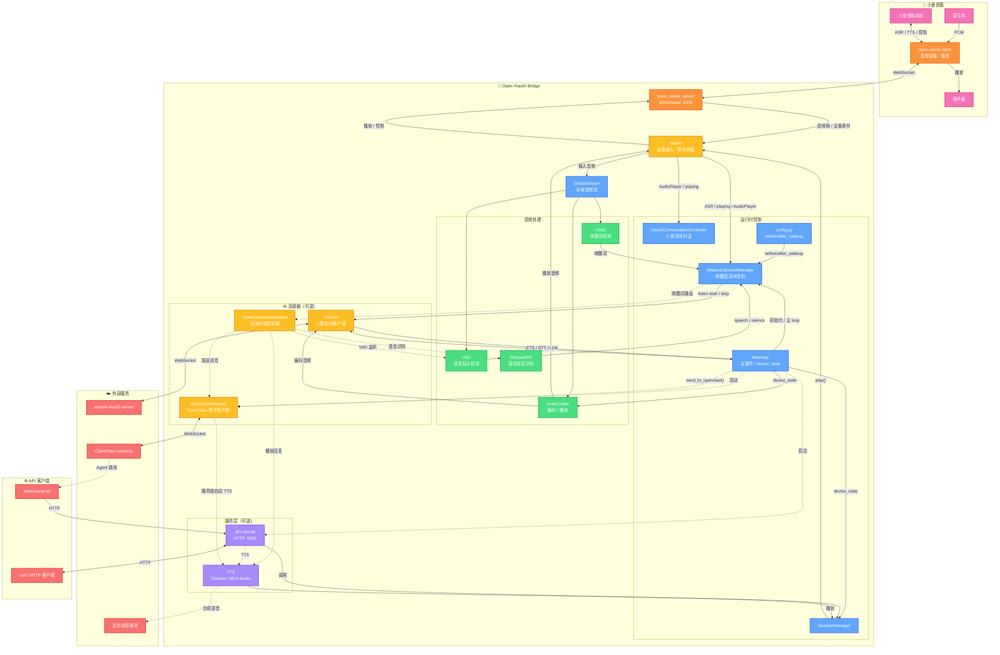

<div align="center">

# Open-XiaoAI Muse

[](https://www.python.org/) [](https://www.rust-lang.org/) [](LICENSE)

**基于 open-xiaoai 的小爱音箱 AI 中枢：“你好缪斯”唤醒，接入 Hermes 等外部 AI 服务**

接管小爱音箱的音频输入输出：本地唤醒、识别，播报中可打断；也保留小智 AI、OpenClaw、QwenPaw 等接入和 HTTP API。

[📖 快速开始](#-快速开始) · [🔊 TTS 配置](#-tts-配置) · [🔌 OpenAI 兼容服务](#-openai-兼容服务) · [🐾 QwenPaw 集成](#-qwenpaw-集成) · [🦞 OpenClaw 集成](#-openclaw-集成) · [🔧 API 文档](#-api-server) · [🐛 常见问题](#-常见问题)

> 本项目由 [coderzc/open-xiaoai-bridge](https://github.com/coderzc/open-xiaoai-bridge) 分叉而来，并移植了 [OwnDing/open-xiaoai](https://github.com/OwnDing/open-xiaoai) 的回声消除、唤醒调优等能力；两者都源自 [idootop/open-xiaoai](https://github.com/idootop/open-xiaoai)。详见[致谢](#致谢)。

</div>

***

## ✨ 功能一览

| 功能                 | 说明                                                                             |
| ------------------ | ------------------------------------------------------------------------------ |
| 🎼 **你好缪斯**        | 自定义唤醒词进入 Hermes 连续对话，流式回复分段播报                                             |
| 🗣️ **播报中打断**       | 音箱发回播放回采，回声消除后播报时也能听见唤醒词；可选多麦唤醒                                   |
| 🔌 **OpenAI 兼容服务** | 接入 Hermes Agent API Server、OpenAI、Ollama、LM Studio 等 `/v1/chat/completions` 服务 |
| 🐾 **QwenPaw 集成**   | 接入 [QwenPaw](https://github.com/agentscope-ai/QwenPaw) HTTP Console 任务接口，支持指定 Agent 和会话 |
| 🦞 **OpenClaw 集成** | 接入 [OpenClaw](https://github.com/openclaw/openclaw)，支持连续对话，可选豆包 TTS 或小爱原生 TTS  |
| 🤖 **小智 AI 集成**    | 接入 [xiaozhi-esp32-server](https://github.com/xinnan-tech/xiaozhi-esp32-server) 实时音频流 |
| 🎙️ **自定义唤醒词**     | 支持中英文，不同唤醒词可路由到不同 AI 服务或不同 OpenClaw Agent                                      |
| 🧠 **多 Agent 路由**  | 一台音箱，多个唤醒词，每个唤醒词对应不同的 OpenClaw Agent Session，动态切换零开销                           |
| 💬 **连续对话**        | 多轮对话无需反复唤醒，喊"小爱同学"可随时打断                                                        |
| ⚡ **VAD + KWS**    | 语音活动检测前置，减少无效识别，更省电                                                            |
| 🌐 **HTTP API**    | 远程播放文字/音频、控制音箱                                                                 |
| 🧩 **模块化**         | 各功能独立开关，按需启用                                                                   |

***

## 🚀 快速开始

> **⚠️ 本项目仅包含服务端**，需要先在小爱音箱上安装 Client 端。

### 📦 前置步骤

1. **🔧 刷机** — 更新小爱音箱固件，开启 SSH
   - [刷机教程](https://github.com/idootop/open-xiaoai/blob/main/docs/flash.md)
2. **🛠️ 音箱补丁程序安装 Client** — 在音箱上运行 OwnDing 版 Rust Client（`client-2026.10.09` 或更新）。`native/` 依赖他的二进制音频帧协议，旧版客户端不兼容
   - [Client 安装说明](https://github.com/OwnDing/open-xiaoai/blob/main/packages/client-rust/README.md) · [下载](https://github.com/OwnDing/open-xiaoai/releases)

### 📥 模型文件

如果你启用小智 AI，或 OpenClaw / OpenAI 兼容服务 / QwenPaw 连续对话使用 `local_asr`，需要下载 `VAD + KWS + ASR` 模型文件。

如果 OpenClaw / OpenAI 兼容服务 / QwenPaw 连续对话使用 `xiaoai_asr`，只需要 `VAD + KWS`，不需要本地 ASR 模型。

1. 从上游 coderzc/open-xiaoai-bridge 的 [releases](https://github.com/coderzc/open-xiaoai-bridge/releases/tag/vad-kws-asr-models) 下载模型压缩包
2. 解压到 `core/models/` 目录

### 💻 本地编译

克隆仓库并启动：

```bash
git clone https://github.com/sounfury/open-xiaoai-muse.git
cd open-xiaoai-muse

# 依赖: uv, Rust
# Linux 还需要: pkg-config, patchelf

# 启动（按需设置环境变量）
API_SERVER_ENABLE=1 MUSE_ENABLE=1 HERMES_ENABLE=1 HERMES_BASE_URL=<Hermes 地址>/v1 HERMES_API_KEY=<key> ./scripts/start.sh

# 启用 Client 鉴权（需与音箱端 token 一致）
OPEN_XIAOAI_TOKEN=your-secret-token API_SERVER_ENABLE=1 ./scripts/start.sh
```

### ⚙️ 环境变量

| 变量                   | 说明            | 默认值           |
| -------------------- | ------------- | ------------- |
| `XIAOZHI_ENABLE`     | 启用小智 AI     | 禁用            |
| `OPENCLAW_ENABLE`    | 启用 OpenClaw | 禁用            |
| `HERMES_ENABLE` | 启用 Hermes Agent（`HERMES_BASE_URL` / `HERMES_API_KEY` / `HERMES_MODEL` 覆盖 config） | 禁用 |
| `OPENAI_ENABLE` | 启用通用 OpenAI 兼容服务（`OPENAI_BASE_URL` / `OPENAI_API_KEY` / `OPENAI_MODEL` 覆盖 config） | 禁用        |
| `QWENPAW_ENABLE` | 启用 QwenPaw | 禁用        |
| `MUSE_ENABLE`        | 启用小爱管家（"你好缪斯"）唤醒词，见[小爱管家](#-小爱管家你好缪斯) | 禁用 |
| `MUSE_WAKE_WORDS`    | 小爱管家 ASR 唤醒词集合，用 `,` `，` `、` 分隔（替换 config `muse.wake_words`） | 见[唤醒词](#唤醒词) |
| `MUSE_KWS_WAKE_WORDS` | 并入本地 KWS 的小爱管家唤醒词（替换 config `muse.kws_wake_words`） | 见[唤醒词](#唤醒词) |
| `API_SERVER_ENABLE`  | 启用 HTTP API | 禁用            |
| `AUDIO_INPUT_ENABLE` | 启用音频输入（关闭后小智/KWS/local\_asr不可用） | 启用            |
| `API_SERVER_HOST`    | API 监听地址（建议保持 `127.0.0.1`，仅本机可调用） | `127.0.0.1`   |
| `API_SERVER_PORT`    | API 监听端口    | `9092`        |
| `API_SERVER_TOKEN`   | API 鉴权 token，设置后 `/api/*`（`/api/health` 除外）需携带 `Authorization: Bearer <token>` | 不鉴权 |
| `OPEN_XIAOAI_TOKEN`  | Client 鉴权 token，设置后仅持有相同 token 的 Client 才能连接 | 不鉴权 |
| `CONFIG_PATH`        | 自定义配置文件路径   | `./config.py` |
| `LOGLEVEL`           | 日志级别        | `INFO`        |

***

## 🏗️ 系统架构



### 工作流程

**🎯 小智唤醒与对话**

```
麦克风 → client → server → XiaoAI → GlobalStream → KWS/小爱 ASR
→ WakeupSessionManager → before_wakeup() → VAD speech/silence
→ XiaoZhi start/stop listening → xiaozhi-esp32-server
```

**🔄 小爱连续对话**

```
小爱 ASR / AudioPlayer 事件 → XiaoAIConversationController
→ 决定继续唤醒或退出
```

**🦞 OpenClaw 单次对话**

```
小爱指令 "让龙虾 xxx" → before_wakeup() → send_to_openclaw()
→ OpenClawManager → Gateway → Agent
→ 自动 TTS 播报 或 Agent 主动调用 xiaoai-tts skill
```

**🦞 OpenClaw 连续对话**

```
唤醒词 "你好龙虾" → WakeupSessionManager → ExternalConversationController(OpenClawManager)
→ local_asr: VAD 检测语音 → SherpaASR 离线识别 → OpenClaw → TTS 播放
→ xiaoai_asr: 静默唤醒小爱 → 接管小爱原生 ASR → OpenClaw → TTS 播放
→ 说"退出"/"再见"退出
```

**🌐 远程控制**

```
curl POST /api/play/text → API Server → SpeakerManager → 小爱音箱
```

***

## 🔌 API Server

设置 `API_SERVER_ENABLE=1` 启用，默认端口 **9092**，默认只监听 `127.0.0.1`。

**可选鉴权**：设置 `API_SERVER_TOKEN` 后，除 `/api/health` 外的接口都需要携带 `Authorization: Bearer <token>`，否则返回 `401`；未设置时保持无鉴权。监听 `0.0.0.0`（如 Docker）时建议同时设置 token。`skills/xiaoai-tts` 通过环境变量 `OPENXIAOAI_API_TOKEN` 传入同一个 token。

### 📡 端点列表

| 方法     | 路径                       | 说明           |
| ------ | ------------------------ | ------------ |
| `POST` | `/api/play/text`         | 播放文字（TTS）    |
| `POST` | `/api/play/url`          | 播放音频链接       |
| `POST` | `/api/play/file`         | 上传并播放音频文件    |
| `POST` | `/api/tts/doubao`        | 豆包 TTS 合成并播放 |
| `GET`  | `/api/tts/doubao_voices` | 获取可用音色列表     |
| `POST` | `/api/wakeup`            | 唤醒小爱音箱       |
| `POST` | `/api/interrupt`         | 打断当前播放       |
| `GET`  | `/api/status`            | 获取播放状态       |
| `GET`  | `/api/health`            | 健康检查         |

### 💡 使用示例

```bash
# 播放文字
curl -X POST http://localhost:9092/api/play/text \
  -H "Content-Type: application/json" \
  -d '{"text": "你好，我是小爱同学"}'

# 播放音频链接
curl -X POST http://localhost:9092/api/play/url \
  -H "Content-Type: application/json" \
  -d '{"url": "https://example.com/audio.mp3"}'

# 上传音频文件
curl -X POST http://localhost:9092/api/play/file \
  -F "file=@/path/to/audio.mp3"

# 豆包 TTS（可指定音色）
curl -X POST http://localhost:9092/api/tts/doubao \
  -H "Content-Type: application/json" \
  -d '{"text": "你好", "speaker_id": "zh_female_cancan_mars_bigtts"}'

# 打断播放
curl -X POST http://localhost:9092/api/interrupt

# 设置了 API_SERVER_TOKEN 时；request_id 可选，用于日志关联并原样返回
curl -X POST http://127.0.0.1:9092/api/play/text \
  -H "Authorization: Bearer $API_SERVER_TOKEN" \
  -H "Content-Type: application/json" \
  -d '{"text": "好的，已安排", "request_id": "reminder-001"}'
```

***

## 🔊 TTS 配置

Bridge 的 TTS provider 配置跟随各个后端，配置层级保持不变：

- `openai.tts_provider`、`openclaw.tts_provider` 和 `qwenpaw.tts_provider` 都可以选择小爱原生、豆包、官方 OpenAI / 兼容服务或本地 MLX-Audio。
- 各后端继续使用自己的 `tts_speaker`、`session_tts_speakers` 或 `agent_tts_speakers`；不填写 `tts_provider` 时，保持旧逻辑：`xiaoai` 使用小爱原生，其他音色 ID 使用豆包。

### 选择 TTS provider

在对应后端配置中增加 `tts_provider` 即可，原有的 `tts_speaker` 不需要删除：

```python
"openai": {
    "tts_provider": "mlx_audio",  # xiaoai / doubao / openai / mlx_audio
    "tts_speaker": "xiaoai",
}
```

同样的字段也可以放在 `openclaw` 和 `qwenpaw` 中：

```python
"openclaw": {
    "tts_provider": "doubao",
    "tts_speaker": "zh_male_raphael_bigtts",
},
"qwenpaw": {
    "tts_provider": "xiaoai",
    "tts_speaker": "xiaoai",
}
```

| `tts_provider` | 运行位置 | 额外配置 |
|---|---|---|
| `xiaoai` | 音箱本地原生 TTS | 无，音色由小爱设备决定 |
| `doubao` | 火山引擎云端 TTS | `tts.doubao`，需要 `app_id` 和 `access_key` |
| `openai` | 官方 OpenAI 或其他兼容服务 | `tts.openai` |
| `mlx_audio` | Mac 本地 MLX-Audio 服务 | `tts.mlx_audio` |

### 小爱原生 TTS

不需要启动额外服务，直接使用音箱自带的合成能力：

```python
"openai": {
    "tts_provider": "xiaoai",
    "tts_speaker": "xiaoai",
}
```

### 豆包 TTS

先在 [火山引擎语音合成控制台](https://www.volcengine.com/docs/6561/1871062) 开通服务，然后配置鉴权信息和默认音色：

```python
"tts": {
    "doubao": {
        "app_id": "你的 App ID",
        "access_key": "你的 Access Key",
        "default_speaker": "zh_female_vv_uranus_bigtts",
        "audio_format": "pcm",
        "stream": True,
    },
},
"openai": {
    "tts_provider": "doubao",
    # 填豆包音色 ID 可覆盖 default_speaker；填 xiaoai 则使用 default_speaker
    "tts_speaker": "xiaoai",
}
```

音色 ID 见 [火山引擎音色库](https://www.volcengine.com/docs/6561/1257544?lang=zh)。豆包的流式配置和声音复刻说明见下方 [豆包 TTS 常见问题](#-豆包-tts-常见问题)。

### OpenAI / 兼容服务 TTS

适用于官方 OpenAI，以及实现 `POST /v1/audio/speech` 的其他服务。在需要使用它的后端中配置 `tts_provider = "openai"`，然后填写共享的 `tts.openai`：

```python
"tts": {
    "openai": {
        "base_url": "https://api.openai.com/v1",
        "api_key": "your-api-key",
        "model": "gpt-4o-mini-tts",
        "voice": "alloy",
        "instructions": "自然、放松地说话，不要播音腔。",
        "response_format": "wav",
        "speed": 1.0,
        "timeout": 120,
        "stream_format": "audio",
        "extra_body": {},
    },
},
"openai": {
    "tts_provider": "openai",
    "tts_speaker": "xiaoai",  # 改成具体 voice ID 可覆盖 tts.openai.voice
}
```

适配器发送标准非流式字段：`model`、`input`、`voice`、`instructions`、`response_format` 和 `speed`。当前音箱播放链路支持 `mp3`、`flac`、`wav`、`ogg`、`pcm`；协议层虽然接受 `opus` 和 `aac`，但这两种格式不适合作为 Bridge 的音箱播放格式。当前不支持流式 TTS，设置 `stream_format = "sse"` 或在 `extra_body` 中启用 `stream` 会明确报错。

### MLX-Audio TTS

适用于 Apple Silicon 本地部署的 [MLX-Audio](https://github.com/Blaizzy/mlx-audio) 服务。在需要使用它的后端中配置 `tts_provider = "mlx_audio"`；Bridge 和 MLX-Audio 不在同一台机器时，把 `base_url` 改成 Mac 的局域网地址：

```python
"tts": {
    "mlx_audio": {
        "base_url": "http://127.0.0.1:8000/v1",
        "api_key": "",
        "model": "mlx-community/Qwen3-TTS-12Hz-1.7B-VoiceDesign-6bit",
        "mode": "voice_design",  # 或 "custom_voice"
        "voice": None,             # VoiceDesign 不需要预设音色
        "lang_code": "Chinese",
        "response_format": "wav",
        "speed": 1.0,
        "instruct": "年轻男性，自然聊天，标准普通话，无明显地域口音。",
        "timeout": 120,
        "extra_body": {},
    },
},
"openai": {
    "tts_provider": "mlx_audio",
    "tts_speaker": "xiaoai",
}
```

`voice_design` 用 `instruct` 描述音色，`custom_voice` 使用模型提供的 `voice`。适配器复用 OpenAI TTS 的 HTTP、鉴权、超时和错误处理，同时把标准 `instructions` 映射为 MLX-Audio 的 `instruct`，并额外支持 `lang_code` 等本地模型参数。协议层支持 `wav`、`mp3`、`flac`、`ogg` 和 `opus`；交给音箱播放时建议使用 `wav`、`mp3`、`flac` 或 `ogg`，不支持 `stream=true`。

### 音频格式与流式限制

- 本地音箱播放优先使用 `wav`；云端服务可根据延迟和带宽选择 `mp3` 或 `pcm`。
- OpenAI / MLX-Audio 适配器当前采用“完整音频文件 → 音箱播放”，不把 SSE 音频流当作完整文件处理。
- 豆包 TTS 保留独立的 `stream` 配置，可使用 PCM 或 MP3 流式播放。

***

## 🔌 OpenAI 兼容服务

有两个后端，都走 OpenAI Chat Completions 接口，不依赖 OpenClaw 协议：

| 后端 | 路由名 / 配置段 | 启用 | 说明 |
| --- | --- | --- | --- |
| Hermes Agent | `"hermes"` | `HERMES_ENABLE=1` | Hermes API Server：一次唤醒一个服务端会话（`X-Hermes-Session-Id`）、长期记忆作用域（`X-Hermes-Session-Key`）、工具进度事件（"稍等"、放音乐后结束对话）。见 `core/hermes.py` |
| 通用 OpenAI 兼容 | `"openai"` | `OPENAI_ENABLE=1` | OpenAI、Ollama、LM Studio 等；每轮只发当前一句（加 `system_prompt`），没有多轮上下文 |

环境变量 `<HERMES|OPENAI>_BASE_URL` / `_API_KEY` / `_MODEL` 覆盖 config 里的值（密钥可以不写进仓库）。

`config.py` 示例（Hermes；通用 OpenAI 的 `"openai"` 段去掉 `session_header` / `session_id_header` / `tool_filler` / `end_after_tools` 即可）：

```python
"hermes": {
    "base_url": "http://127.0.0.1:8000/v1",
    "api_key": "",  # Hermes 的 API_SERVER_KEY；不配置时 Hermes 不接受会话 ID
    "model": "muse-home",
    "input_mode": "local_asr",  # 或 "xiaoai_asr"
    "session_key": "agent:default:open-xiaoai-bridge",  # 长期记忆作用域，改了读不到以前的记忆
    "session_header": "X-Hermes-Session-Key",
    "session_id_header": "X-Hermes-Session-Id",  # 一次唤醒一个服务端会话
    "system_prompt": "",
    "temperature": 0.7,
    "max_tokens": 512,
    "tts_provider": "xiaoai",  # 详见「🔊 TTS 配置」
    "tts_speaker": "xiaoai",
}
```

TTS provider 的选择和音频参数见上方 [🔊 TTS 配置](#-tts-配置)。

触发连续对话时，在 `before_wakeup` 中返回路由名（下例用通用 OpenAI；Hermes 返回 `"hermes"`）：

```python
async def before_wakeup(speaker, text, source, app):
    if source == "kws" and "小黑" in text:
        await speaker.play(text="小黑来了")
        return "openai"

    if source == "xiaoai" and text == "召唤小黑":
        await speaker.abort_xiaoai()
        return "openai"
```

单次发送并播报：

```python
if "让小黑" in text:
    await speaker.abort_xiaoai()
    await app.send_to_openai_and_play_reply(text.replace("让小黑", ""))
    return None
```

`base_url` 可以直接填到 `/v1`，框架会自动调用 `/chat/completions`；如果你的服务已经给出完整 `/v1/chat/completions` 地址，也可以直接填写完整地址。

Hermes 的会话由服务端管理：每次唤醒进入连续对话时生成一个新的会话 ID，这次唤醒的每一轮都带 `X-Hermes-Session-Id`，只发当前这一句，Hermes 从自己的数据库读回本次唤醒的对话和工具调用结果；退出对话（再见、超时、被打断）后丢掉，下次唤醒换新的。bridge 本地不保存历史，跨唤醒的连续性靠 Hermes 长期记忆（`session_key` 通过 `X-Hermes-Session-Key` 发送）。Hermes 要求配置 `api_key` 才接受会话 ID。需要隔离多个助手的长期记忆时，可在唤醒前调用 `app.set_hermes_session_key("assistant-name")`。

### 流式回复和分段播报

连续对话默认用流式回复（`"stream": True`）：

- 回复边生成边切成段，第一句出来就开始播（切段参数见 `conversation.reply_segments`）。
- `tts_speaker = "xiaoai"` 时用小爱原生 TTS 流水线：后面的段用 `mibrain text_to_speech save=1` 提前生成，再依次 `miplayer` 播放，段间几乎不停顿；其他 TTS 按段依次合成播放。
- 只读 `delta.content`，模型的 `reasoning_content` 不读；朗读前去掉 Markdown 符号、链接、表情和 `<think>` 块。
- Hermes 会发 `hermes.tool.progress` 事件：开始调用工具、还没有正文时先念一句"稍等"（搜索类工具念"我查一下"），见 `hermes.tool_filler`；调用了 `hermes.end_after_tools` 里的工具（放音乐）时回答完就结束对话。
- 回采在线时，从发出请求到播完都可以用唤醒词打断。
- 服务端不支持流式时会自动按普通 JSON 回复处理；设 `"stream": False` 回到等整段回复再播。

## 🐾 QwenPaw 集成

用于接入阿里的 [QwenPaw](https://github.com/agentscope-ai/QwenPaw)。桥接器会调用 QwenPaw 的 HTTP Console 后台任务接口，将小爱音箱识别到的文本发送给指定 Agent，并把回复通过小爱或豆包 TTS 播放出来。

先启动 QwenPaw，再用 `QWENPAW_ENABLE=1 ./scripts/start.sh` 启动桥接器。QwenPaw 不在同一台机器时，把 `base_url` 改成它的局域网地址，例如 `http://192.168.1.10:8088`。

`config.py` 示例：

```python
"qwenpaw": {
    "base_url": "http://127.0.0.1:8088",
    "agent_id": "default",
    "user_id": "open-xiaoai-bridge",
    "input_mode": "local_asr",  # 或 "xiaoai_asr"
    "session_key": "open-xiaoai-bridge",
    "send_path": "/api/console/chat/task",
    "task_status_path": "/api/console/chat/task/{task_id}",
    "auth_token": "",
    "tts_speaker": "xiaoai",
}
```

触发连续对话时，在 `before_wakeup` 中返回 `"qwenpaw"`：

```python
async def before_wakeup(speaker, text, source, app):
    if source == "kws" and "小爪" in text:
        await speaker.play(text="小爪来了")
        return "qwenpaw"

    if source == "xiaoai" and text == "召唤小爪":
        await speaker.abort_xiaoai()
        return "qwenpaw"
```

单次发送并播报：

```python
if "让小爪" in text:
    await speaker.abort_xiaoai()
    await app.send_to_qwenpaw_and_play_reply(text.replace("让小爪", ""))
    return None
```

`agent_id` 会通过 `X-Agent-Id` 请求头发送给 QwenPaw；`session_key` 对应 QwenPaw 请求里的 `session_id`，需要隔离多个对话时可在唤醒前调用 `app.set_qwenpaw_session_key("speaker-session")`。

`auth_token` 是可选项，非空时程序默认会附带 `Authorization` 认证头，不需要额外配置 `auth_header` / `auth_scheme`。如果你的部署要求自定义认证头，可按需增加：

```python
"qwenpaw": {
    "auth_header": "X-API-Key",
    "auth_scheme": "",
    "auth_token": "your-token",
}
```

`auth_scheme` 设为空字符串时，请求头会直接发送 `auth_token` 原始值。

## 🦞 OpenClaw 集成

通过 [OpenClaw](https://github.com/openclaw/openclaw) 将小爱音箱变成你的 AI Agent 终端。

设置 `OPENCLAW_ENABLE=1` 启用（兼容旧值 `OPENCLAW_ENABLED`）

### 🎯 交互方式

#### 🎙️ 方式一：连续对话

用自定义唤醒词触发后进入多轮对话循环，支持两种输入模式：

```
local_asr: 本地 VAD + SherpaASR
xiaoai_asr: 接管小爱原生 ASR
```

`config.py` 示例：

```python
"openclaw": {
    "input_mode": "xiaoai_asr",  # 或 "local_asr"
}
```

- 说"退出"或"再见"退出对话
- 小爱唤醒时自动打断 TTS 并退出
- 退出关键词可自定义
- `xiaoai_asr` 模式下不需要本地 ASR 模型

触发方式见下方[自定义唤醒词](#-自定义唤醒词)，`before_wakeup` 返回 `"openclaw"` 即进入连续对话。

#### 💬 方式二：单次对话（发送并播报）

通过小爱语音指令发送一条消息给 Agent，收到回复后自动 TTS 播报：

```python
# config.py 中的 before_wakeup
if "让龙虾" in text:
    await speaker.abort_xiaoai()
    await app.send_to_openclaw_and_play_reply(text.replace("让龙虾", ""))
    return None  # 框架不做额外处理
```

用户说"让龙虾查一下明天天气" → 打断小爱 → 发给 Agent → TTS 播报回复。

#### 📡 方式三：单次对话（Agent 自主播报）

只发送消息，不自动播报，由 Agent 调用 `xiaoai-tts` skill 自主播报：

```python
if "告诉龙虾" in text:
    await speaker.abort_xiaoai()
    await app.send_to_openclaw(text.replace("告诉龙虾", ""))
    return None
```

`send_to_openclaw()` 会自动追加 `rule_prompt_for_skill`（配置在 `config.py` 中），告诉 Agent 需要调用 skill 播报。适合 Agent 需要做复杂处理后再决定是否/如何播报的场景。

### 🎙️ 自定义唤醒词

唤醒词在 `config.py` 的 `wakeup.keywords` 中定义，支持中英文混合：

```python
"wakeup": {
    "keywords": [
        "你好小智",        # 中文
        "小智小智",
        "hi openclaw",    # 英文（全小写）
        "你好龙虾",
        "龙虾你好",
    ],
},
```

不同唤醒词可以路由到不同 AI 服务，在 `before_wakeup` 中根据文本内容判断：

```python
async def before_wakeup(speaker, text, source, app):
    if source == "kws":          # 唤醒词触发
        if "龙虾" in text:
            await speaker.play(text="龙虾来了")
            return "openclaw"    # → OpenClaw 连续对话
        if "小智" in text:
            await speaker.play(text="小智来了")
            return "xiaozhi"     # → 小智 AI
        return None              # → 不处理

    if source == "xiaoai":       # 小爱语音指令
        if text == "召唤龙虾":
            await speaker.abort_xiaoai()
            return "openclaw"
        if text == "召唤小智":
            await speaker.abort_xiaoai()
            return "xiaozhi"
    # 返回 None → 交给小爱原生处理
```

**返回值含义：** `"hermes"` → Hermes 连续对话，`"openai"` → 通用 OpenAI 兼容服务连续对话，`"openclaw"` → OpenClaw 连续对话，`"qwenpaw"` → QwenPaw 连续对话，`"xiaozhi"` → 小智 AI，`None` → 不处理（用户可自行调用 `app.send_to_backend(name, text)`，或 `app.send_to_openclaw()` / `app.send_to_hermes()` 等快捷方法）。后端名对应 `core/backends.py` 的注册表，对应后端没启用时只记错误日志、不进入对话。

### 🧠 多 Agent 路由 — 一个唤醒词，一个专属 Agent

`set_openclaw_session_key()` 让你在发送消息前动态切换目标 Agent Session，**无需重连，无性能开销**。结合自定义唤醒词，可以实现：

> **一台音箱，N 个专属 AI 助手，按名字呼唤谁，谁就来响应。**

```python
# config.py

AGENT_SESSIONS = {
    "龙虾": "agent:assistant:open-xiaoai-bridge",
    "小美": "agent:xiaomei:open-xiaoai-bridge",
    "管家": "agent:butler:open-xiaoai-bridge",
}

async def before_wakeup(speaker, text, source, app):
    if source == "kws":
        for keyword, session_key in AGENT_SESSIONS.items():
            if keyword in text:
                app.set_openclaw_session_key(session_key)  # 切换到对应 Agent
                await speaker.play(text=f"{keyword}来了")
                return "openclaw"                          # 进入连续对话

    if source == "xiaoai":
        for keyword, session_key in AGENT_SESSIONS.items():
            if f"召唤{keyword}" in text:
                app.set_openclaw_session_key(session_key)
                await speaker.abort_xiaoai()
                return "openclaw"
```

配合唤醒词配置：

```python
"wakeup": {
    "keywords": [
        "你好龙虾", "你好小美", "你好管家",
    ],
},
```

此后你说"**你好龙虾**"，进入的是龙虾 Agent 的上下文；说"**你好小美**"，进入的是小美 Agent 的上下文 —— 同一台音箱，完全隔离的多个 AI 人格。

退出时同样可以区分是哪个 Agent 结束了对话。`after_wakeup` 在 OpenClaw 退出时会收到 `session_key` 参数，取第二段即为 `agentId`：

```python
async def after_wakeup(speaker, source=None, session_key=None):
    if source == "openclaw":
        # session_key 格式：agent:<agentId>:<rest>，第二段即 agentId
        agent_id = session_key.split(":")[1] if session_key else None
        if agent_id == "assistant":
            await speaker.play(text="龙虾，再见")
        elif agent_id == "xiaomei":
            await speaker.play(text="小美，再见")
        elif agent_id == "butler":
            await speaker.play(text="管家，再见")
        else:
            await speaker.play(text="再见")
    if source == "xiaozhi":
        await speaker.play(text="小智，再见")
```

### 📝 rule_prompt — 约束 Agent 输出格式

有两个 prompt 配置，分别用于不同的播报场景：

| 配置 | 使用场景 | 自动追加位置 |
|------|---------|-------------|
| `rule_prompt` | 自动播放、连续对话 | `send_to_openclaw_and_play_reply()`、连续对话循环 |
| `rule_prompt_for_skill` | Agent 自主播报（方式三） | `send_to_openclaw()` |

**为什么需要两个 prompt？**

- **`rule_prompt`**：服务端会自动 TTS 播放，只需告诉 Agent 输出纯文字、控制字数
- **`rule_prompt_for_skill`**：服务端不会自动播放，需要告诉 Agent **主动调用 `xiaoai-tts` skill** 来播报

示例配置：

```python
"openclaw": {
    # 自动播放/连续对话用：约束输出格式
    "rule_prompt": "注意：将结果处理成纯文字版，不要返回任何 markdown 格式，也不要包含任何代码块，并将字数控制在300字以内",
    # Agent 自主播报用：告诉 Agent 需要调用 skill
    "rule_prompt_for_skill": "注意：这条消息是主人通过小爱音箱发送的，他看不到你回复的文字，调用 `xiaoai-tts` skill 播报出来。字数控制在300字以内",
}
```

不需要可以留空或不设置。

### 🎵 OpenClaw TTS 音色

`openclaw.tts_provider` 决定使用哪一种 TTS provider，`openclaw.tts_speaker` 决定音色或 voice。现在可以这样配置：

```python
"openclaw": {
    "tts_provider": "mlx_audio",
    "tts_speaker": "xiaoai",  # 使用 tts.mlx_audio.voice 或 instruct
}
```

如果不填写 `tts_provider`，则保持旧行为，`tts_speaker` 支持两种值：

| 值          | 效果       | 说明                                                    |
| ---------- | -------- | ----------------------------------------------------- |
| `"xiaoai"` | 小爱原生 TTS | 零配置即可使用，音色由设备决定                                       |
| 豆包音色 ID    | 豆包语音合成   | 需配置 `tts.doubao` 的 `app_id` 和 `access_key`，详见 [TTS 配置](#-tts-配置) |

如果希望不同 Agent 使用不同音色，可以配置 `openclaw.agent_tts_speakers`。它会根据当前 `session_key` 中的 `agentId` 选择对应音色；未命中时回退到 `openclaw.tts_speaker`。

```python
"openclaw": {
    # 默认音色：未命中 agent_tts_speakers 时使用
    "tts_speaker": "xiaoai",
    # 按 agentId 覆盖音色
    "agent_tts_speakers": {
        "main": "xiaoai",
        "assistant": "zh_female_vv_uranus_bigtts",
        "xiaomei": "zh_female_shuangkuaisisi_moon_bigtts",
        "butler": "zh_male_raphael_bigtts",
    },
}
```

例如当前 `session_key` 是 `agent:assistant:open-xiaoai-bridge`，则会使用 `assistant` 对应的音色。

### 🧩 Skills

`skills/xiaoai-tts/` — Agent 通过 HTTP API 控制小爱播放语音，支持小爱内置 TTS 和豆包 TTS。

📖 详见 [SKILL.md](skills/xiaoai-tts/SKILL.md)

***

## 🤖 小智 AI 集成

接入 [xiaozhi-esp32-server](https://github.com/xinnan-tech/xiaozhi-esp32-server)，使用小智 AI 的对话能力。

设置 `XIAOZHI_ENABLE=1` 启用

### 配置

```python
APP_CONFIG = {
    "xiaozhi": {
        "OTA_URL": "http://127.0.0.1:8003/xiaozhi/ota/",
        "WEBSOCKET_URL": "ws://127.0.0.1:8000/xiaozhi/v1/",
        "WEBSOCKET_ACCESS_TOKEN": "",  # 可选
        # "DEVICE_ID": "",  # 可选，默认自动生成
    },
}
```

### 使用

唤醒词触发后，`before_wakeup` 返回 `"xiaozhi"` 即进入小智对话流程。

详见[自定义唤醒词](#-自定义唤醒词)章节。

***

## 🎼 小爱管家（你好缪斯）

本项目新增的唤醒词：说 **"你好缪斯"**，进入 Hermes Agent（当前部署连接云端 Hermes，模型 `muse-home`）的连续对话，路由为 `"hermes"`。**"小爱同学"原生链路不受影响**。

需要同时设置 `MUSE_ENABLE=1`（启用缪斯唤醒词，会同时启用 KWS 关键词生成和 VAD/KWS）和 `HERMES_ENABLE=1`（启用对话后端，见 [OpenAI 兼容服务](#-openai-兼容服务)）。
主动提醒计划直接使用 Oracle 上现有的米家云端播报接口，不要求本机 bridge 在线；工具和定时任务的接入验收见独立的 [Hermes PRD](docs/hermes-prd.md)。本机 `POST /api/play/text` 仍可供本地应用使用。

### 触发方式

| 说法 | 来源 | 行为 |
| --- | --- | --- |
| "你好缪斯" / "嗨缪斯" / "hey muse"（本地 KWS 命中） | `kws` | 进入 Hermes 连续对话 |
| "小爱同学" → "你好缪斯" / "Hey Muse" | `xiaoai` | 等于某个 KWS 唤醒词：按外部唤醒词处理（拦截原生对话），进入连续对话 |
| "小爱同学" → "你好缪斯，我今晚想洗澡" / "缪斯" | `xiaoai` | 拦截原生小爱回复（`muse.native_suppress`），进入连续对话 |
| "小爱同学，开灯" / "我喜欢缪斯" / "museum 门票多少钱" | `xiaoai` | 原生小爱处理 |

> 本地 KWS 唤醒会按音频位置补录同一句中唤醒词后的内容；原生小爱 ASR 的文本入口仍会进入对话后重新监听一句。

**播报中打断**（`APP_CONFIG["barge_in"]`，需要 OwnDing 版音箱客户端，只在 OH2P 上验证过）：音箱同时发回播放回采，bridge 消除回声后播报时也开着麦克风。
对话中回答还没说完时喊"你好缪斯"，会立即停下并直接听下一句；"你好缪斯，明天天气怎么样"一口气说完，后半句也会带进去。回采不在线时自动退回"播报时关麦"。
灯效和原生小爱一致：提示音 / 回答时是播报灯 3（随播放声音起伏）→ 等你说是短白灯 41 → 你说话时白光随你的音量变宽 → 思考 2 → 播报 3，见 `core/services/conversation_light.py`。白光随音量需要音箱能连到 bridge 的 4400 端口（`conversation.light_level`，见 `core/services/light_level.py`）；连不上时退回静止白光。

唤醒和播报中被打断时，会随机说一句应答语（"我在"/"在"/"哎"…），可在 `conversation.wake_reply` 里改词或关闭；小爱原生 TTS 时用小爱自己的声音，第一次生成后缓存在音箱上。连续 `wakeup.timeout`（默认 20）秒没开口会自动退出。

### 唤醒词

唤醒词是一个**集合**（口误、ASR 误识别都能命中），分两层：

| 层 | 配置 | 默认 | 说明 |
| --- | --- | --- | --- |
| ASR 文本前缀匹配 | `MUSE_WAKE_WORDS` > `muse.wake_words`（再加上 `wake_word`、`wake_word_aliases`、KWS 子集） | 52 个写法，见下 | 小爱原生 ASR / 本地 KWS 的识别文本都走这里 |
| 本地 KWS（常驻监听） | `MUSE_KWS_WAKE_WORDS` > `muse.kws_wake_words` | `你好缪斯` `嗨缪斯` `哈喽缪斯` `hi muse` `hey muse` `hello muse` | `MUSE_ENABLE=1` 时生成 `keywords.txt` 自动并入 `wakeup.keywords`（去重），无需手动重复 |

默认 ASR 集合（`config.py` 的 `muse.wake_words`，与 `core/muse.py` 的 `DEFAULT_WAKE_WORDS` 一致）：

- 正写 / 英文：`你好缪斯` `嗨缪斯` `哈喽缪斯` `嘿缪斯` `hi缪斯` `hey缪斯` `hello缪斯` `hi muse` `hey muse` `hello muse` `你好muse` `嗨muse` `哈喽muse` `嘿muse`
- 单独的名字：`缪斯` `muse`
- 同音字（miù sī），可带问候语（你好 / 嗨 / 哈喽 / 嘿），也可单独使用：`缪思` `缪丝` `谬斯` `谬思`
- 近音字，**只接受带问候语**（你好 / 嗨 / 哈喽 / 嘿）：`妙思` `妙斯` `木斯` `慕斯`——它们本身是常见词（妙思泉涌、佳木斯、慕斯蛋糕）

匹配规则（`core/muse.py` 的 `parse_muse_text`）：

1. **归一化**：先做 NFKC（全角 → 半角）、忽略大小写，再去掉所有空白和中英文标点（包括 sherpa 英文关键词结果里的 `▁`）。所以 `hi muse` 同时匹配 `Hi Muse`、`himuse`、`Hi，Muse！`、`ＨＩ　ＭＵＳＥ`；`你好缪斯` 匹配 `你好，缪斯`。
2. **只在句首**（`muse.match_mode = "prefix"`）：句首的标点、空白和语气词可以跳过。语气词由 `muse.leading_fillers` 配置，默认 `嗯 呃 额 啊 喂 诶 欸 哎 um uh hmm emm`，可重复出现，设为 `[]` 关闭。`"我喜欢缪斯"`、`"今天妙思路清晰"` 不会触发。`"那个"` 不在默认语气词里，因为它也是指示代词（"那个缪斯是谁"）。旧的 `"contains"` 模式仍可显式开启，但会让单独的"缪斯"/"muse"严重误触发，不建议使用。
3. **最长优先**：`你好缪斯` 先于 `缪斯`，`hey muse` 先于 `muse`。
4. **英文词边界**：以英文字母结尾的唤醒词，后面紧跟的字符不能是英文字母或数字。`museum`、`musea`、`mused`、`hi museum` 不触发；`muse, 开灯`、`muse开灯`、`Muse 我今晚想洗澡` 触发。
5. **中文不设词边界**：ASR 经常不打标点，`缪斯开灯` 必须能匹配；代价是 `缪斯特罗姆` 这类以"缪斯"开头的罕见说法也会触发。所以容易和常见词混淆的近音字只收带问候语的写法。
6. **解析结果**：`MuseMatch.wake_word` 是命中的那一项在配置里的写法（说"嗨，缪思"得到 `"嗨缪思"`，KWS 返回 `hi▁muse` 得到 `"hi muse"`）；`MuseMatch.content` 是去掉唤醒词及其后标点的部分（`"Hey Muse！！ 开灯"` → `"开灯"`），只剩语气词或标点时为空。

**为什么 KWS 只放 6 个**：KWS 模型（`tokens.txt` + `bpe.model`，`cjkchar+bpe`）对上面所有候选都能编码——汉字全在词表里，英文走 BPE（`hi muse` → `▁HI ▁MU S E`，`hey muse` → `▁HE Y ▁MU S E`）。但 KWS 是常驻监听的：

- 单独的 `缪斯` / `muse` 只有 2 个音节，常驻监听下误唤醒风险高，所以只走 ASR 前缀（需要先说"小爱同学"）；
- KWS 按汉字建模，`缪斯` / `谬斯` / `缪思` 是不同的 token 序列，每多一种写法就多一条常驻误唤醒路径。同音字和近音字交给 ASR 前缀匹配兜底；实测发现 KWS 漏掉某种写法时，再用 `MUSE_KWS_WAKE_WORDS` 补上；
- 生成 `keywords.txt` 时逐条编码，含模型词表外字符的关键词会被跳过并打印警告，不影响其他后端的关键词。

KWS 子集里的词始终参与 ASR 匹配，`muse.wake_word` 也始终在集合里。用 `MUSE_WAKE_WORDS` 替换集合时，如果也不想要默认的 KWS 词，同时设置 `MUSE_KWS_WAKE_WORDS`（或在 config 里把 `kws_wake_words` 设为 `[]`）：

```bash
MUSE_WAKE_WORDS="你好缪斯，缪斯，hey muse、muse" \
MUSE_KWS_WAKE_WORDS="你好缪斯,hey muse" ./scripts/start.sh
```

路由在 `config.py` 的 `before_wakeup` 里：

```python
from core.muse import match_muse_text, suppress_native_xiaoai

if match_muse_text(text):          # MUSE_ENABLE 未开启时恒为 None
    if source == "xiaoai":
        await suppress_native_xiaoai(speaker)
    return "hermes"
```

> 使用自定义 `config.py`（`CONFIG_PATH`）时，需要把上面这段 `before_wakeup` 代码和 `APP_CONFIG["muse"]` 一起合并进去，否则不会触发。
> 旧配置里没有 `wake_words` / `kws_wake_words` / `leading_fillers` 时使用代码里的默认值；KWS 子集在生成 `keywords.txt` 时自动并入，`wakeup.keywords` 里不需要再写缪斯唤醒词（写了也会去重）。

### 配置

| 项 | 环境变量 / `APP_CONFIG["muse"]` | 默认值 |
| --- | --- | --- |
| 唤醒词 | `MUSE_WAKE_WORDS` / `wake_words`、`MUSE_KWS_WAKE_WORDS` / `kws_wake_words`、`wake_word`、`wake_word_aliases`、`leading_fillers`、`match_mode` | 见[唤醒词](#唤醒词)；`match_mode` 默认 `prefix` |
| 原生拦截 | `native_suppress` | `abort`（同 `召唤龙虾` 示例，重启小爱约 1-2 秒）；可选 `dialog`、`none` |

对话本身（地址、模型、输入模式、提示语、灯效）都在 `APP_CONFIG["hermes"]` 里配置。

### 无音箱测试

```bash
python -m pytest tests/test_muse*.py
python -m unittest discover -s tests -p "test_muse*.py"
```

接上音箱后：

```bash
MUSE_ENABLE=1 HERMES_ENABLE=1 API_SERVER_ENABLE=1 HERMES_BASE_URL=<Hermes 地址>/v1 HERMES_MODEL=muse-home HERMES_API_KEY=<key> API_SERVER_TOKEN=<本机 API token，可选> ./scripts/start.sh
```

***

## ❓ 常见问题

### 🎙️ 唤醒词与连续对话

1. **模型文件在哪下载？**

    小智 AI 和 `local_asr` 模式需要 `VAD + KWS + ASR` 模型文件。  
    `xiaoai_asr` 模式只需要 `VAD + KWS`。

    详见[快速开始 - 模型文件](#-模型文件)。

2. **如何切换 ASR 语音识别模型？**

    仅 `openclaw.input_mode = "local_asr"` 时，ASR 配置才会生效。在 `config.py` 中配置：

    ```python
    APP_CONFIG = {
        "asr": {
            "model": "sense_voice",  # "sense_voice"（默认）/ "paraformer" / "fire_red_asr" / "doubao"
            "int8": True,            # 本地模型优先加载 INT8 量化模型
            # "model_dir": "sherpa-onnx-fire-red-asr-xxx",  # 可选：显式指定本地模型目录
        },
    }
    ```

    | 模型 | 说明 | 特点 |
    |------|------|------|
    | `sense_voice` | [SenseVoice-Small](https://github.com/FunAudioLLM/SenseVoice) | 多任务语音理解模型，支持中/英/日/韩/粤五语种自动识别，附带语言检测、ITN 和情感识别，推理极快 |
    | `paraformer` | [Paraformer-Trilingual](https://github.com/modelscope/FunASR) | 专注语音转写的工业级非自回归模型，支持中文/英文/粤语，中文识别精度高 |
    | `fire_red_asr` | [FireRedASR](https://github.com/FireRedTeam/FireRedASR) | FireRedASR 是一系列开源的工业级自动语音识别 (ASR) 模型，支持普通话、汉语方言和英语，在公开的普通话 ASR 基准测试中达到了新的最先进水平 (SOTA)，同时还提供了出色的歌词识别能力。 |
    | `doubao` | [火山引擎豆包语音识别](https://www.volcengine.com/docs/6561/1354868?lang=zh) | 云端录音文件识别，支持标准版和极速版，需要配置火山引擎 App Key / Access Key |

    使用本地模型时，将对应模型目录放到 `core/models/` 下即可，不配置默认使用 `sense_voice`。

    使用豆包 ASR 时，将 `model` 改为 `"doubao"`，并填写 `asr.doubao`：

    ```python
    APP_CONFIG = {
        "asr": {
            "model": "doubao",
            "doubao": {
                # "standard": 录音文件识别标准版，调用 /submit + /query
                # "flash": 录音文件极速版，调用 /recognize/flash
                "mode": "standard",
                "app_key": "你的 App Key",
                "access_key": "你的 Access Key",
                # 火山 X-Api-Resource-Id：
                # standard 可选：
                #   "volc.bigasr.auc"  - 豆包录音文件识别模型 1.0
                #   "volc.seedasr.auc" - 豆包录音文件识别模型 2.0
                # flash 可选：
                #   "volc.bigasr.auc_turbo" - 录音文件极速版
                "resource_id": "volc.seedasr.auc",
                "language": "",
                "submit_timeout": 10,
                "query_timeout": 10,
                "poll_interval": 0.5,
                "max_wait_seconds": 20,
            },
        },
    }
    ```

    `standard` 模式会把本地 PCM 封装为 wav 后以 base64 提交到标准版接口；如果你的火山账号不支持该请求形式，可切换为 `flash` 并将 `resource_id` 改为 `"volc.bigasr.auc_turbo"`。

3. **如何打断 AI 的回答？**

    直接喊"小爱同学"即可打断小智或 OpenClaw 的回答。

4. **话没说完 AI 就开始回答？**

    调大 `min_silence_duration`：

    ```python
    APP_CONFIG = {
        "vad": {
            "min_silence_duration": 1000,  # 毫秒
        },
    }
    ```

5. **唤醒词没反应？**

    - 调低 `vad.threshold`（越小越灵敏，如 `0.05`）
    - 启动后需等约 30s 加载模型
    - 英文唤醒词用空格分开（如 `"open ai"`）
    - 换更易识别的唤醒词

6. **麦克风音量太小，唤醒词 / ASR 识别不准？**

    在 `config.py` 中调大输入增益：

    ```python
    APP_CONFIG = {
        "audio_input": {
            "gain": 2.0  # 增益倍数，1.0 = 不处理；建议从 2.0 开始逐步调整
        },
    }
    ```

    > 增益过高会引入失真，反而影响识别，适度调整即可。

7. **如何播放服务端本地音频文件？**

    可以直接调用：

    ```python
    await speaker.play(server_file="/path/to/hello.wav")
    ```

    这里的路径是**运行桥接器的这台机器**上的本地文件路径，不是音箱里的路径。

### 🦞 OpenClaw

1. **首次连接出现 pairing required？**

    正常流程。保持服务在线，到 OpenClaw UI 批准设备：**Nodes → Devices → Approve**。

2. **重新部署后需要重新配对？**

    设备身份存在 `identity_path` 目录（默认 `app/openclaw/identity/`），重新部署时把它一起带上，否则需要重新配对。

3. **session\_key 是什么？**

    告诉 Gateway 把消息路由到哪个 Agent Session，格式为冒号分隔的层级路径：

    ```
    agent:<agentId>:<rest>
    ```

    | 字段          | 说明                                 | 示例                          |
    | ----------- | ---------------------------------- | --------------------------- |
    | `agent`     | 固定前缀                               | `agent`                     |
    | `<agentId>` | OpenClaw 中配置的 Agent ID（默认为 `main`） | `main`、`assistant`          |
    | `<rest>`    | 会话标识，可自由命名，用于区分不同来源/场景             | `home`、`open-xiaoai-bridge` |

    常见格式举例：

    ```
    agent:main:open-xiaoai-bridge          # 默认值（本项目）
    agent:main:main                        # OpenClaw 原生默认主会话
    agent:assistant:open-xiaoai-bridge     # 指定其他 Agent
    agent:main:direct:alice                # 按用户隔离
    ```

4. **如何在运行时动态切换 session\_key？**

    每次唤醒触发 `before_wakeup` 之前，框架会自动将 `session_key` **重置为配置文件中的默认值**。因此：

    - 在 `before_wakeup` 中调用 `app.set_openclaw_session_key()` → 本次唤醒使用指定的 session
    - 不调用 → 自动使用配置文件中的 `openclaw.session_key`，不会沿用上一次的值

    这意味着你只需要在需要切换的路径里调用一次，不用担心"忘记重置"的问题。

    常见使用场景：

    **场景一：按唤醒词路由到不同 Agent**

    说"你好龙虾"唤醒龙虾 Agent，说"你好小美"唤醒小美 Agent：

    ```python
    AGENT_SESSIONS = {
        "龙虾": "agent:assistant:open-xiaoai-bridge",
        "小美": "agent:xiaomei:open-xiaoai-bridge",
        "管家": "agent:butler:open-xiaoai-bridge",
    }

    async def before_wakeup(speaker, text, source, app):
        if source == "kws":
            for keyword, session_key in AGENT_SESSIONS.items():
                if keyword in text:
                    app.set_openclaw_session_key(session_key)
                    await speaker.play(text=f"{keyword}来了")
                    return "openclaw"
    ```

    **场景二：每次唤醒生成独立 Session**

    每次对话互相隔离，适合以下情况：

    - "提问 → 回答"式交互，不需要 Agent 记住上下文
    - 长期使用同一 Session 导致 Agent 上下文堆积过长，影响响应质量和速度

    ```python
    import uuid

    def new_session_key():
        return f"agent:main:session-{uuid.uuid4().hex[:8]}"

    async def before_wakeup(speaker, text, source, app):
        if source == "kws" and "龙虾" in text:
            app.set_openclaw_session_key(new_session_key())
            await speaker.play(text="龙虾来了")
            return "openclaw"
    ```

5. **send\_to\_openclaw() 的返回值是什么？**

    - `send_to_openclaw(text)` → 成功返回 `run_id`（str），失败返回 `None`
    - `send_to_openclaw(text, wait_response=True)` → 成功返回回复文本，超时/失败返回 `None`
    - `send_to_openclaw_and_play_reply(text)` → 同上，但会自动 TTS 播放回复

### 🤖 小智 AI

1. **第一次运行提示验证码绑定设备？**

    打开小智 AI [管理后台](https://xiaozhi.me/)，根据提示创建 Agent 绑定设备。验证码会在终端打印或写入 `config.py`：

    ```python
    APP_CONFIG = {
        "xiaozhi": {
            "VERIFICATION_CODE": "首次登录时，验证码会在这里更新",
        },
    }
    ```

    绑定成功后可能需要重启应用。

2. **怎样使用自己部署的 xiaozhi-esp32-server？**

    修改 `config.py` 中的接口地址：

    ```python
    APP_CONFIG = {
        "xiaozhi": {
            "OTA_URL": "https://your-server/xiaozhi/ota/",
            "WEBSOCKET_URL": "wss://your-server/xiaozhi/v1/",
        },
    }
    ```

### 🎵 豆包 TTS 常见问题

1. **如何配置豆包 TTS？**

    配置示例、provider 选择和音色说明见上方 [🔊 TTS 配置](#-tts-配置) 的「豆包 TTS」小节。

2. **如何使用声音复刻？**

   1. 在[火山引擎控制台](https://console.volcengine.com/speech/service/10036?AppID=)「声音复刻详情」中获取预分配的 Speaker ID（格式 `S_xxxxxxxx`）
   2. 准备一段 10-30 秒清晰人声音频（支持 wav/mp3/m4a 等，≤10MB）
   3. 运行克隆脚本：
   ```bash
   python3 scripts/clone_voice.py --speaker-id S_xxxxxxxx --audio sample.wav
   ```
   训练完成后会输出 demo 试听链接和可用的模型类型（ICL 1.0 / ICL 2.0）。
   4. **重要**：确保复刻音色与 `tts.doubao.app_id` 属于**同一个火山引擎项目**，否则无法使用。
3. **如何将指定文本转成特定音色的音频文件？**

   可以使用脚本 [scripts/generate\_tts.py](scripts/generate_tts.py)：
   ```bash
   python3 scripts/generate_tts.py \
     --speaker-id zh_male_lengkugege_emo_v2_mars_bigtts \
     --text "你好，今天心情很好" \
     --emotion happy \
     --output ./output/happy.wav
   ```
   其中 `--speaker-id` 必填，`--text` 和 `--text-file` 二选一，`--output` 用来指定输出文件名；`--emotion` 仅部分多情感音色支持。

4. **支持流式播放吗？怎么配置？**

   支持。推荐配置：
   ```python
   "tts": {
       "doubao": {
           "stream": True,           # 流式播放，首音延迟更低
           "audio_format": "pcm",    # 局域网推荐，首音更快
           # "audio_format": "auto", # 短文本 PCM，长文本 MP3
       }
   }
   ```
   - `pcm`：首音快，流式稳定，长文本总耗时可能更高
   - `mp3`：传输效率高，长文本更早结束
   - `auto`：折中方案，按文本长度自动选择

   冒烟测试（无需音箱，验证 TTS 是否正常）：
   ```bash
   python3 tests/test_tts_stream.py                                           # 测试流式 TTS 连通性
   python3 tests/test_tts_latency.py --formats mp3,pcm --rounds 3 --repeat 8  # 对比 mp3/pcm 延迟
   ```

## 致谢

本项目建立在三个 MIT 项目之上，版权声明见 [LICENSE](./LICENSE)：

- [idootop/open-xiaoai](https://github.com/idootop/open-xiaoai)（Del Wang）：小爱音箱刷机、音箱端 Client 和 `examples/xiaozhi/` 示例，是下面两个项目的共同来源。
- [coderzc/open-xiaoai-bridge](https://github.com/coderzc/open-xiaoai-bridge)（coderzc）：本项目的分叉基础（上游 `a1f77a8`，2026-10-10）。整体框架、小智 AI / OpenClaw / QwenPaw / OpenAI 兼容服务接入、TTS、HTTP API 和模型文件都来自这里。
- [OwnDing/open-xiaoai](https://github.com/OwnDing/open-xiaoai)（基于 commit `7ecea6f`）：子带回声消除（`core/services/audio/aec.py`）和音箱播放回采、唤醒调优（每词阈值、错开起点的多路检测）、退出词规则、小爱原生 TTS 分段播放，以及 `native/` 依赖的 Rust crate（二进制音频帧、心跳和超时）。移植记录见 [docs/ownding-migration-plan.md](docs/ownding-migration-plan.md)。

***

## 🚨 免责声明

本项目为非官方技术研究项目，与小米及其关联公司不存在任何隶属、合作、授权、认可或背书关系。

使用者应自行确认其使用行为符合适用法律法规、平台规则、设备厂商政策及相关服务协议，并自行承担由下载、安装、配置、修改、传播或使用本项目所产生的全部风险与责任。

详细免责声明请见 [DISCLAIMER.md](./DISCLAIMER.md)。项目授权与分发条件以仓库中的 [LICENSE](./LICENSE) 文件为准。

***

## 📚 参考资源

| 资源              | 链接                                                                                                                                                                                                                                                       |
| --------------- | -------------------------------------------------------------------------------------------------------------------------------------------------------------------------------------------------------------------------------------------------------- |
| 🔧 刷机教程         | [刷机教程](https://github.com/idootop/open-xiaoai/blob/main/docs/flash.md)                                                                                                                                                                                   |
| 🛠️ Client 端安装  | [Client 端安装（OwnDing 版）](https://github.com/OwnDing/open-xiaoai/blob/main/packages/client-rust/README.md)                                                                                                                                                            |
| 🎙️ 豆包 TTS 音色列表 | [火山引擎文档](https://www.volcengine.com/docs/6561/1257544)                                                                                                                                                                                                   |

***

<div align="center">

**Maintained by** **[sounfury](https://github.com/sounfury)** · 基于 [coderzc](https://github.com/coderzc)、[OwnDing](https://github.com/OwnDing)、[idootop](https://github.com/idootop) 的工作

</div>
